<div align="center">
  

  # FinanApp — Gestión Financiera Inteligente

  **Plataforma Full-Stack de control de flujo de efectivo diario, amortización de microdeudas y metas de ahorro diseñada para trabajadores independientes e informales.**

  [](https://angular.dev/)
  [](https://spring.io/projects/spring-boot)
  [](https://www.oracle.com/java/)
  [](https://www.postgresql.org/)
  [](https://tailwindcss.com/)
  [](https://www.docker.com/)
  [](http://localhost:8081/swagger-ui/index.html)

</div>

---

##  Tabla de Contenidos
- [Contexto y Propuesta de Valor](#-contexto-y-propuesta-de-valor)
- [Funcionalidades Principales](#-funcionalidades-principales)
- [Capturas de la Aplicación](#-capturas-de-la-aplicación)
- [Arquitectura del Sistema](#-arquitectura-del-sistema)
- [Stack Tecnológico Real](#-stack-tecnológico-real)
- [Estructura del Proyecto](#-estructura-del-proyecto)
- [Modelo de Datos (Diagrama ER)](#-modelo-de-datos-diagrama-er)
- [Catálogo de Endpoints de la API](#-catálogo-de-endpoints-de-la-api)
- [Seguridad y Control de Acceso](#-seguridad-y-control-de-acceso)
- [Pruebas Automatizadas](#-pruebas-automatizadas)
- [Instalación y Ejecución Local](#-instalación-y-ejecución-local)
- [Documentación Swagger UI](#-documentación-swagger-ui)
- [Autor](#-autor)

---

## Contexto y Propuesta de Valor

En América Latina, más del **50% de la fuerza laboral** opera en la economía independiente o informal (comerciantes, transportadores, freelancers, artesanos, repartidores). A diferencia del trabajador asalariado tradicional:
* **Ingresos variables:** No perciben una nómina fija mensual; sus ingresos y egresos fluctúan drásticamente día tras día.
* **Presión de microdeudas ("paga diario"):** Frecuente dependencia de créditos informales con intereses diarios o semanales asfixiantes.
* **Falta de visibilidad:** Las aplicaciones bancarias tradicionales están diseñadas para presupuestos mensuales corporativos o fijos, no para la dinámica del día a día.

**FinanApp** transforma esta realidad mediante una plataforma integral que ofrece:
1. **Flujo de Caja en Tiempo Real:** Registro y balance diario inmediato de ingresos y egresos con desglose neto.
2. **Algoritmo de Cuota Diaria de Seguridad:** Divide el saldo pendiente de cada obligación entre los días hábiles/restantes hacia el vencimiento, indicando exactamente cuánto dinero debe apartarse hoy para cumplir a tiempo.
3. **Cajitas de Ahorro con Trazabilidad:** Metas financieras que descuentan automáticamente el aporte de la contabilidad diaria y reintegran el dinero al saldo en caso de retiro.
4. **Protección Contable Inmutable:** Las transacciones vinculadas a pagos de créditos o ahorros están protegidas contra manipulaciones inconsistentes.

---

##  Funcionalidades Principales

* **Dashboard Analítico:** Visualización en vivo del balance del día (ingresos, gastos y saldo neto), cuota de seguridad diaria consolidada y progreso de metas.
* **Control de Transacciones:** Registro ágil de ingresos y gastos, clasificados por categorías del sistema o personalizadas.
* **Gestión de Obligaciones Recurrentes:** Registro de créditos y deudas con cálculo dinámico de estados (`PENDIENTE`, `PAGADA`, `VENCIDA`) e historial de abonos.
* **Cajitas y Metas de Ahorro:** Creación de metas con monto objetivo, fecha límite, progreso porcentual, aportes continuos y retiros automáticos.
* **Categorías Personalizables:** Categorías base protegidas y creación ilimitada de categorías propias con iconos representativos.
* **Centro de Notificaciones:** Detección y alertas en tiempo real sobre obligaciones próximas a vencer o vencidas, metas alcanzadas y recordatorios de registro diario.
* **Perfil y Auditoría:** Modificación de perfil de usuario y soporte de desactivación lógica de cuenta (*Soft Delete*).

---

## 📸 Capturas de la Aplicación

### 📱 Vistas Principales de la Aplicación

<div align="center">
  <table>
    <tr>
      <th align="center">Dashboard Principal</th>
      <th align="center">Flujo de Transacciones</th>
      <th align="center">Obligaciones y Cuota</th>
    </tr>
    <tr>
      <td align="center">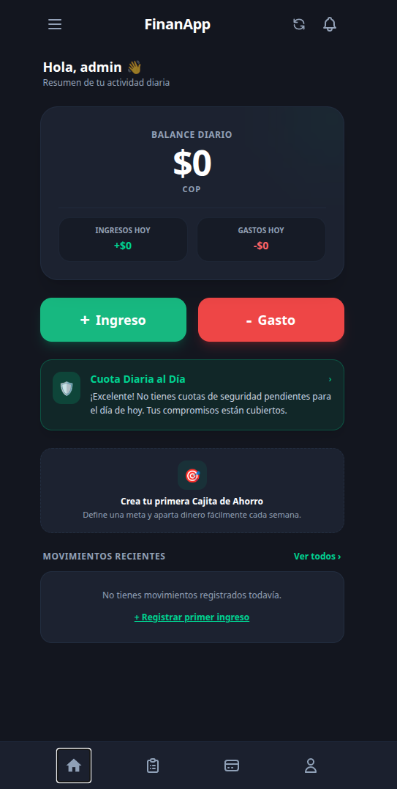</td>
      <td align="center">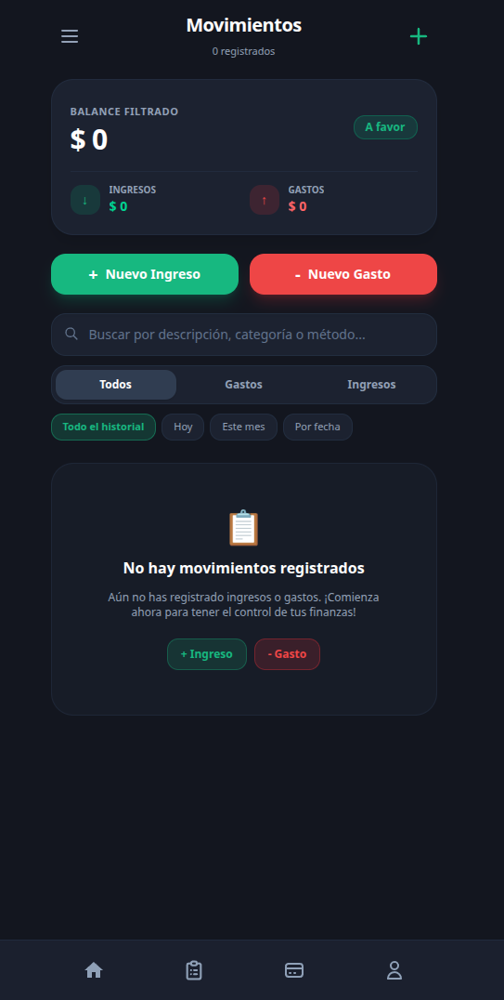</td>
      <td align="center">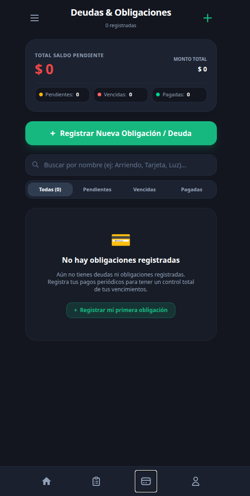</td>
    </tr>
    <tr>
      <th align="center">Metas de Ahorro</th>
      <th align="center">Centro de Notificaciones</th>
      <th align="center">Perfil de Usuario</th>
    </tr>
    <tr>
      <td align="center">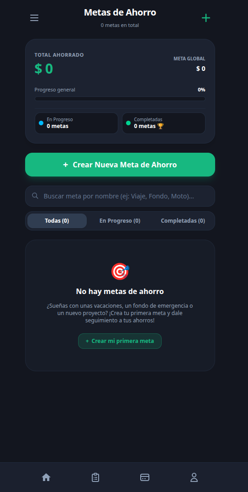</td>
      <td align="center">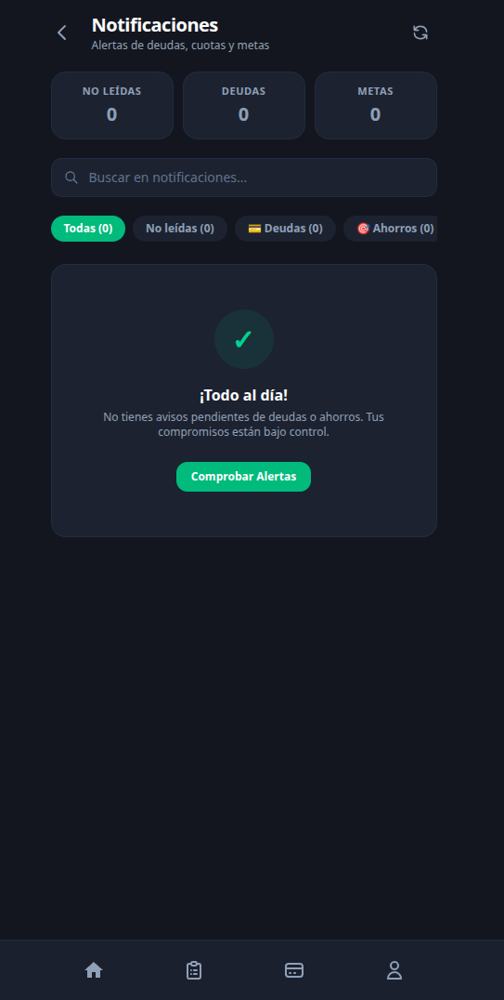</td>
      <td align="center">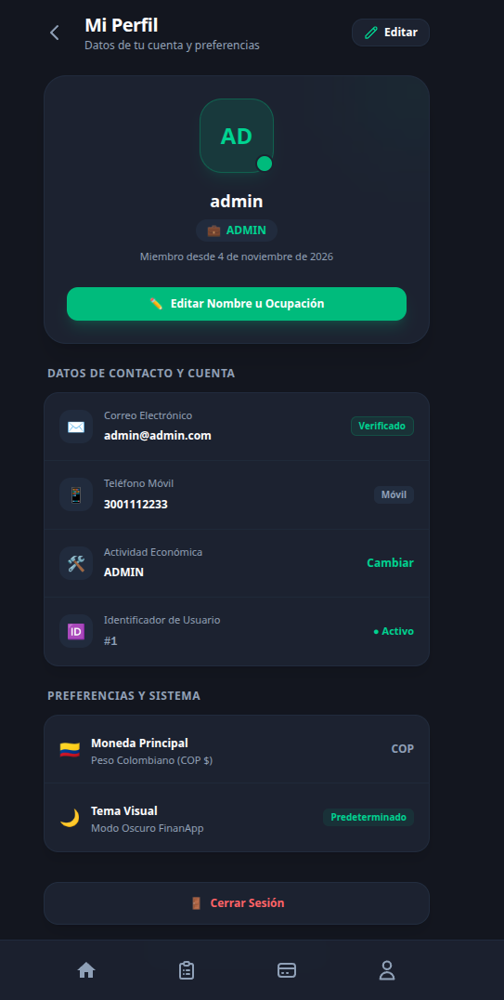</td>
    </tr>
    <tr>
      <th align="center">Inicio de Sesión</th>
      <th align="center">Registro de Cuenta</th>
      <th align="center">-</th>
    </tr>
    <tr>
      <td align="center">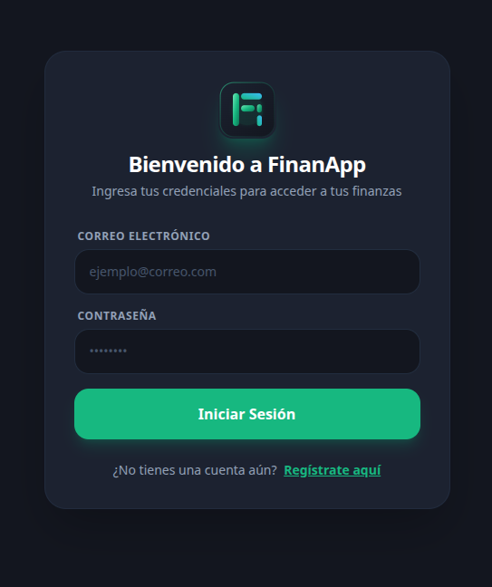</td>
      <td align="center">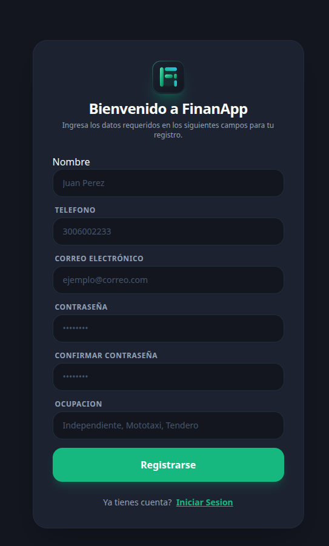</td>
      <td align="center">-</td>
    </tr>
  </table>
</div>

### 📑 Documentación OpenAPI (Swagger UI)

<div align="center">
  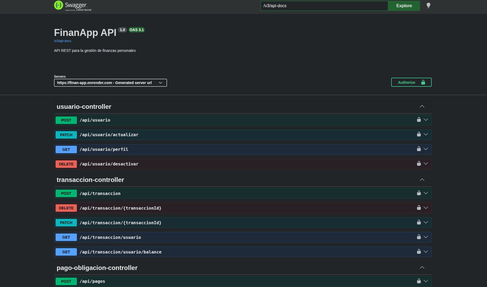
  <p><i>Catálogo interactivo de endpoints REST con autenticación Bearer JWT y contratos tipados.</i></p>
</div>

##  Arquitectura del Sistema

FinanApp implementa una **Arquitectura Cliente-Servidor Desacoplada (SPA + API RESTful)** estructurada bajo principios **SOLID**, inmutabilidad y separación estricta de responsabilidades:

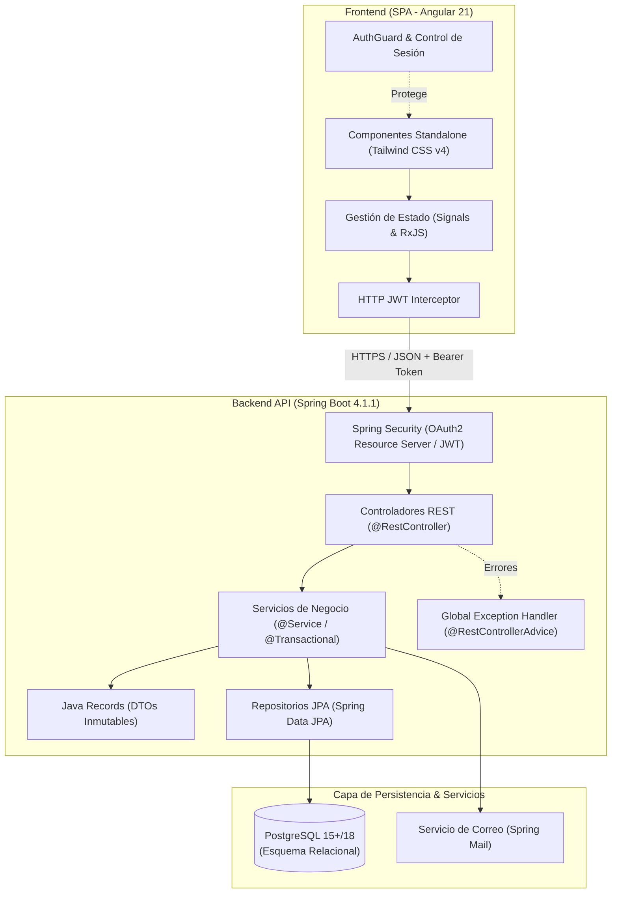

### Principios y Patrones Aplicados:
* **Clean Architecture & Layered Design:** Capa de presentación desacoplada del dominio y de la infraestructura.
* **DTOs Inmutables con Java Records:** Blindaje de las entidades JPA de base de datos; la API solo expone e ingesta `records`.
* **Seguridad Stateless con Bearer Tokens:** Emisión y validación criptográfica de tokens JWT firmados con algoritmo HMAC-SHA256 (`Nimbus JOSE JWT`).
* **Frontend Reactivo con Angular Signals:** Reactividad de grano fino para balance, notificaciones y estado de sesión sin sobrecarga de ciclos de detección.
* **Soft Delete:** Eliminación lógica de usuarios, metas y obligaciones (`activo = false`) para garantizar la persistencia de auditoría histórica y no romper referencias contables.
* **Manejo Estandarizado de Errores:** Errores serializados con formato canónico (`timestamp`, `status`, `error`, `message`, `path`).

---

## 🛠 Stack Tecnológico Real

###  Frontend (SPA)
| Componente | Tecnología | Versión | Propósito |
| :--- | :--- | :--- | :--- |
| **Framework** | [Angular](https://angular.dev/) | `^21.2.0` | Arquitectura Standalone, Control Flow (`@if`, `@for`) y Signals |
| **Lenguaje** | [TypeScript](https://www.typescriptlang.org/) | `~5.9.2` | Tipado estático y robustez en cliente |
| **Estilos** | [Tailwind CSS](https://tailwindcss.com/) | `^4.3.3` | Motor de utilidades CSS moderno con `@tailwindcss/postcss` |
| **Reactividad** | [RxJS](https://rxjs.dev/) | `~7.8.0` | Manejo de flujos asíncronos y eventos reactivos |
| **Pruebas** | [Vitest](https://vitest.dev/) | `^4.0.8` | Suite moderna de pruebas unitarias (12 suites, 69 tests) |
| **Enrutador** | Angular Router | `^21.2.0` | Navegación SPA con Guards de protección (`authGuard`) |

###  Backend (API REST)
| Componente | Tecnología | Versión | Propósito |
| :--- | :--- | :--- | :--- |
| **Lenguaje** | [Java OpenJDK](https://openjdk.org/) | `17+ / 25` | Lenguaje principal tipado, moderno y de alto rendimiento |
| **Framework** | [Spring Boot](https://spring.io/projects/spring-boot) | `4.1.1` | Base del servidor web, inyección de dependencias y configuración |
| **Seguridad** | Spring Security + Nimbus JOSE | Integrado | Stateless OAuth2 Resource Server con firma HMAC-SHA256 y BCrypt |
| **Persistencia / ORM** | Spring Data JPA / Hibernate | `7.4.x` | Mapeo objeto-relacional y consultas optimizadas JPQL |
| **Base de Datos** | [PostgreSQL](https://www.postgresql.org/) | `15+ / 18` | Base de datos relacional ACID con soporte de transaccionalidad |
| **Documentación** | SpringDoc OpenAPI | `3.1.0` | Generación automática de especificación OpenAPI 3 y Swagger UI |
| **Pruebas Unitarias**| JUnit 5 + Mockito | Integrado | Pruebas de lógica de negocio y servicios en aislamiento (24 tests) |
| **Build Tool** | Apache Maven | `3.9+` | Gestión de dependencias y ciclo de compilación con wrapper (`mvnw`) |

###  Infraestructura & Despliegue
* **Docker:** Imagen multi-stage en backend optimizada con `eclipse-temurin:17-jre-alpine`.
* **Backend Cloud Target:** Render ([https://finan-app.onrender.com/api](https://finan-app.onrender.com/api)) con soporte de Keep-Alive y variables seguras.
* **Frontend Cloud Target:** Vercel / Cloud Static Hosting compatible con SPA fallback routing.

---

##  Estructura del Proyecto

El repositorio está organizado como un espacio de trabajo modular monorepo:

```
finan-app/
├── assets/                          # Diagramas ER, logos en SVG y PNG
│   ├── img_1.png                    # Diagrama Entidad-Relación
│   └── logos/                       # Identidad visual de FinanApp
│
├── finanapp-frontend/               # Aplicación Cliente (Angular 21 + Tailwind CSS v4)
│   ├── src/
│   │   ├── app/
│   │   │   ├── core/                # Módulo central transversal
│   │   │   │   ├── guards/          # authGuard (protección de rutas privadas)
│   │   │   │   ├── interceptors/   # jwtInterceptor (inyección automática Bearer JWT)
│   │   │   │   ├── models/          # Interfaces TypeScript de dominio
│   │   │   │   └── services/        # Clientes HTTP (Auth, Transacciones, Obligaciones, etc.)
│   │   │   ├── layout/              # Estructura visual: MainLayout, Sidebar interactivo
│   │   │   └── features/            # Módulos de funcionalidad (Lazy Loaded)
│   │   │       ├── auth/            # Login y Registro de usuarios
│   │   │       ├── dashboard/       # Dashboard principal y métricas
│   │   │       ├── transacciones/   # Listado, filtros y creación de movimientos
│   │   │       ├── obligaciones/    # Deudas, cuota de seguridad y abonos
│   │   │       ├── metas-ahorro/    # Cajitas, aportes y retiros
│   │   │       ├── categorias/      # Gestión de categorías de gasto/ingreso
│   │   │       ├── notificaciones/  # Alertas automáticas inteligentes
│   │   │       └── perfil/          # Actualización y desactivación de cuenta
│   │   └── environments/            # Configuraciones (development y production)
│   ├── package.json
│   └── angular.json
│
├── finanapp-backend/                # Servidor API REST (Spring Boot 4.1.1 + Java 17)
│   ├── src/
│   │   ├── main/java/com/finanapp/
│   │   │   ├── config/              # SecurityConfig, CorsConfig, OpenApiConfig
│   │   │   ├── controller/          # Endpoints REST expuestos
│   │   │   ├── dto/                 # Java Records (Request / Response DTOs)
│   │   │   ├── exception/           # GlobalExceptionHandler y excepciones de negocio
│   │   │   ├── model/               # Entidades JPA (Usuario, Transaccion, Obligacion, etc.)
│   │   │   ├── repository/          # Interfaces Spring Data JPA
│   │   │   └── service/             # Lógica y transaccionalidad (@Transactional)
│   │   └── resources/
│   │       └── application.properties # Parámetros de conexión y perfiles
│   ├── Dockerfile                   # Dockerfile multi-stage de producción
│   └── pom.xml                      # Dependencias Maven del backend
└── README.md
```

---

##  Modelo de Datos (Diagrama ER)

El modelo de datos garantiza integridad referencial, normalización y trazabilidad contable:

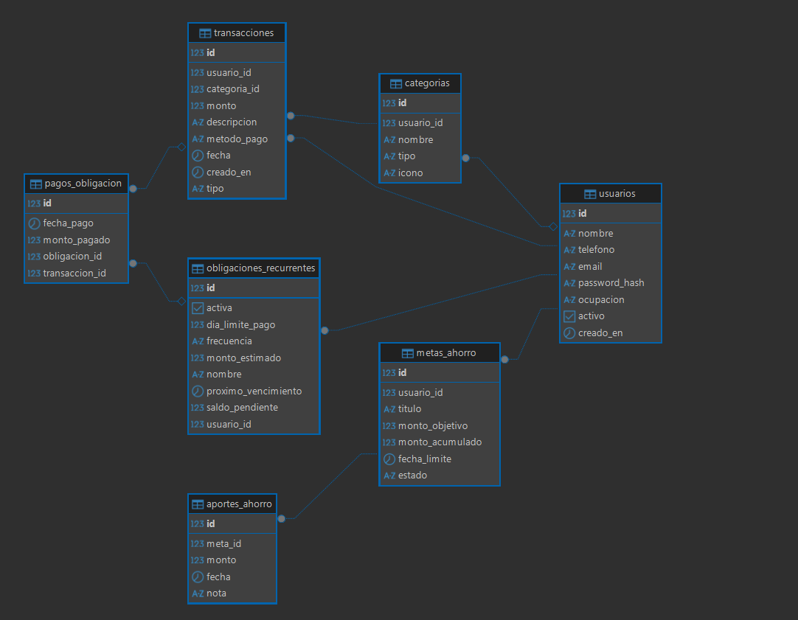

### Entidades y Relaciones Clave:
* **Usuario:** Centro de la aplicación; relación 1 a N con todas sus transacciones, obligaciones, metas y categorías propias. Soporta eliminación lógica (`activo`).
* **Categoría:** Catálogo con categorías globales (`usuario_id IS NULL`) y personalizadas (`usuario_id = X`).
* **Transacción:** Libro diario inmutable con monto, fecha, tipo (`INGRESO` o `GASTO`) y categoría.
* **Obligación Recurrente:** Deuda o compromiso con monto total, saldo pendiente, fecha de vencimiento y estado (`PENDIENTE`, `PAGADA`, `VENCIDA`).
* **Pago Obligación:** Historial de abonos a deudas que crea automáticamente una transacción contable de `GASTO` para mantener la coherencia del balance.
* **Metas Ahorro & Aportes:** Caja de ahorro con monto acumulado y meta final. Cada `AporteAhorro` (tipo `APORTE`) genera un gasto contable, mientras que un `RETIRO` genera un ingreso.

---

##  Catálogo de Endpoints de la API

Todos los endpoints (salvo registro y login) requieren el encabezado:  
`Authorization: Bearer <TOKEN_JWT>`

### 1. Autenticación (`/api/auth`)
| Método | Endpoint | Descripción | Acceso |
| :--- | :--- | :--- | :--- |
| `POST` | `/api/auth/login` | Inicia sesión con email y contraseña. Emite token JWT y datos de perfil. | Público |

### 2. Usuarios (`/api/usuario`)
| Método | Endpoint | Descripción | Acceso |
| :--- | :--- | :--- | :--- |
| `POST` | `/api/usuario` | Registro de usuario (valida unicidad de email y teléfono). | Público |
| `GET` | `/api/usuario/perfil` | Consulta datos del usuario autenticado vía JWT. | Autenticado |
| `PATCH` | `/api/usuario/actualizar` | Actualización de nombre y/u ocupación. | Autenticado |
| `DELETE` | `/api/usuario/desactivar` | Desactivación lógica de la cuenta (*Soft Delete*). | Autenticado |

### 3. Categorías (`/api/categoria`)
| Método | Endpoint | Descripción | Acceso |
| :--- | :--- | :--- | :--- |
| `POST` | `/api/categoria` | Crea una nueva categoría propia para el usuario autenticado. | Autenticado |
| `GET` | `/api/categoria/listar` | Lista categorías globales y propias (`?tipo=INGRESO\|GASTO`). | Autenticado |
| `PATCH` | `/api/categoria/actualizar/{id}` | Edita una categoría creada por el usuario. | Autenticado |
| `DELETE` | `/api/categoria/eliminar/{id}` | Elimina una categoría propia (protege las globales). | Autenticado |

### 4. Transacciones (`/api/transaccion`)
| Método | Endpoint | Descripción | Acceso |
| :--- | :--- | :--- | :--- |
| `POST` | `/api/transaccion` | Registra un ingreso o gasto manual. | Autenticado |
| `GET` | `/api/transaccion/usuario` | Lista transacciones con filtros de rango (`?fechaInicio=&fechaFin=`). | Autenticado |
| `GET` | `/api/transaccion/usuario/balance` | Balance diario consolidado: ingresos, gastos, neto y movimientos (`?fecha=`). | Autenticado |
| `PATCH` | `/api/transaccion/{id}` | Modifica una transacción (bloquea si fue creada por abono a deuda). | Autenticado |
| `DELETE` | `/api/transaccion/{id}` | Elimina una transacción del usuario. | Autenticado |

### 5. Metas de Ahorro (`/api/ahorros-metas`)
| Método | Endpoint | Descripción | Acceso |
| :--- | :--- | :--- | :--- |
| `POST` | `/api/ahorros-metas` | Crea una meta con título, monto objetivo y fecha límite. | Autenticado |
| `GET` | `/api/ahorros-metas` | Lista todas las metas activas del usuario. | Autenticado |
| `GET` | `/api/ahorros-metas/metas` | Filtra metas por estado (`EN_PROGRESO`, `COMPLETADA`, `CANCELADA`). | Autenticado |
| `GET` | `/api/ahorros-metas/ahorrado` | Retorna el total acumulado ahorrado por el usuario. | Autenticado |
| `PATCH` | `/api/ahorros-metas/{id}` | Actualiza meta (verifica si se marca como completada). | Autenticado |
| `DELETE` | `/api/ahorros-metas/{id}` | Cancela lógicamente una meta de ahorro. | Autenticado |

### 6. Aportes y Retiros de Ahorro (`/api/aportes`)
| Método | Endpoint | Descripción | Acceso |
| :--- | :--- | :--- | :--- |
| `POST` | `/api/aportes` | Ingresa dinero a una meta y descuenta contablemente con un `GASTO`. | Autenticado |
| `POST` | `/api/aportes/retiro` | Retira dinero acumulado (valida saldo) y registra un `INGRESO`. | Autenticado |
| `GET` | `/api/aportes/historial/{metaId}` | Historial cronológico de aportes y retiros de una meta. | Autenticado |

### 7. Obligaciones y Deudas (`/api/obligaciones`)
| Método | Endpoint | Descripción | Acceso |
| :--- | :--- | :--- | :--- |
| `POST` | `/api/obligaciones` | Registra una deuda u obligación (frecuencia, monto, fecha límite). | Autenticado |
| `GET` | `/api/obligaciones/usuario` | Lista obligaciones y recalcula automáticamente vencimientos. | Autenticado |
| `GET` | `/api/obligaciones/usuario/activas` | Lista solo obligaciones con saldo pendiente activo. | Autenticado |
| `GET` | `/api/obligaciones/{estado}` | Filtra obligaciones (`PENDIENTE`, `PAGADA`, `VENCIDA`). | Autenticado |
| `GET` | `/api/obligaciones/usuario/cuota-seguridad` | **Cuota Diaria de Seguridad:** Algoritmo de cuota recomendada hoy. | Autenticado |
| `PATCH` | `/api/obligaciones/{id}` | Modifica detalles de una obligación. | Autenticado |
| `DELETE` | `/api/obligaciones/{id}` | Desactiva una obligación (*Soft Delete*). | Autenticado |

### 8. Pagos de Obligaciones (`/api/pagos`)
| Método | Endpoint | Descripción | Acceso |
| :--- | :--- | :--- | :--- |
| `POST` | `/api/pagos` | Realiza abono o pago total, reduce saldo y registra `GASTO` contable. | Autenticado |
| `GET` | `/api/pagos/obligaciones/{id}` | Historial de pagos realizados a una obligación específica. | Autenticado |

---

##  Seguridad y Control de Acceso

1. **Autenticación Stateless (JWT):**
   - El token se firma con una clave secreta de mínimo 256 bits mediante `HmacSHA256`.
   - Vencimiento configurable (por defecto 120 minutos).
   - Inyección transparente en el frontend mediante `jwtInterceptor`.
2. **Control de Rutas y Guards:**
   - Rutas protegidas en el cliente mediante `authGuard` que redirige a `/auth/login` si no existe token válido.
3. **CORS Dinámico:**
   - Configurado en `CorsConfig.java` y `SecurityConfig.java` permitiendo orígenes seguros de desarrollo (`localhost:4200`) y producción (`*.onrender.com`, `*.vercel.app`).
4. **Protección de Contraseñas:**
   - Encriptación unidireccional con algoritmo adaptativo `BCryptPasswordEncoder`.

---

##  Pruebas Automatizadas

El proyecto cuenta con cobertura de pruebas en ambas capas:

### Backend (JUnit 5 + Mockito)
Total: **24 pruebas unitarias automatizadas** cubriendo reglas de negocio críticas:
* `UsuarioTest`: Registro, unicidad de correo y teléfono, encriptación de contraseña y desactivación.
* `AuthLoginTest`: Validación de credenciales, bloqueo de usuarios inactivos y generación de tokens.
* `TransaccionTest`: Creación de movimientos, balance diario y bloqueo de manipulación de pagos vinculados.
* `AporteAhorroTest`: Aportes, completado automático de metas y protección contra sobre-retiros.
* `PagoObligacionTest`: Reducción progresiva de saldos, transición a estado `PAGADA` y prevención de sobrepagos.

Ejecución de pruebas de backend:
```bash
cd finanapp-backend
./mvnw test
```

### Frontend (Vitest + Angular Testing Library)
Total: **12 suites de prueba y 69 tests automatizados** cubriendo componentes, servicios y guards:
* Componentes de autenticación (`Login`, `Registro`).
* Gestión de navegación y menú lateral (`Sidebar`, `MainLayout`).
* Módulos de funcionalidad (`Dashboard`, `Transacciones`, `Obligaciones`, `MetasAhorro`, `Categorias`, `Notificaciones`, `Perfil`).

Ejecución de pruebas de frontend:
```bash
cd finanapp-frontend
npm test -- --no-watch
```

---

## 🚀 Instalación y Ejecución Local

### Prerrequisitos del Entorno
* **Java Development Kit (JDK) 17+** (OpenJDK o Eclipse Temurin)
* **Node.js 18+** y **npm 9+**
* **PostgreSQL 15+** corriendo en el puerto local `5432`
* **Docker & Docker Compose** (opcional, para ejecución automatizada en contenedores)

---

### 1. Clonar el Repositorio
```bash
git clone https://github.com/Navid2405/finan-app.git
cd finan-app
```

---

### 2. Variables de Entorno

####  Backend (`finanapp-backend/.env`)
Crea un archivo `.env` en la raíz de `finanapp-backend/` basándote en la plantilla [`finanapp-backend/.env.example`](finanapp-backend/.env.example):

```bash
cp finanapp-backend/.env.example finanapp-backend/.env
```

| Variable | Tipo | Descripción | Ejemplo / Valor por defecto | Obligatorio |
| :--- | :--- | :--- | :--- | :--- |
| `DB_URL` | String | URL JDBC de conexión a PostgreSQL | `jdbc:postgresql://localhost:5432/finanapp_db` | Sí |
| `DB_USERNAME` | String | Usuario de la base de datos | `postgres` | Sí |
| `DB_PASSWORD` | String | Contraseña del usuario PostgreSQL | `tu_password_aqui` | Sí |
| `PORT` | Integer | Puerto de escucha del servidor Spring Boot | `8081` | No (default `8081`) |
| `JWT_SECRET` | String | Clave criptográfica para firma HMAC-SHA256 (mínimo 32 caracteres) | `MiClaveSuperSeguraMinimo32Caracteres123!` | Sí |

####  Frontend (`finanapp-frontend/src/environments/`)
El frontend cuenta con perfiles de entorno en Angular para dirigir el tráfico de la API:
* **Desarrollo local (`src/environments/environment.development.ts`):**
  ```typescript
  export const environment = {
    production: false,
    apiUrl: 'http://localhost:8081/api'
  };
  ```
* **Producción (`src/environments/environment.ts`):**
  ```typescript
  export const environment = {
    production: true,
    apiUrl: 'https://finan-app.onrender.com/api'
  };
  ```

---

### 3. Configuración de la Base de Datos

1. **Crear la base de datos en PostgreSQL:**
   ```sql
   CREATE DATABASE finanapp_db;
   ```
2. **Generación automática del esquema:**
   Al iniciar el backend, Hibernate (`spring.jpa.hibernate.ddl-auto=update`) creará automáticamente las 7 tablas del modelo (`usuarios`, `categorias`, `transacciones`, `obligaciones_recurrentes`, `pagos_obligacion`, `metas_ahorro`, `aportes_ahorro`).
3. **Poblar categorías globales semilla (Opcional pero recomendado):**
   Para inicializar la app con categorías estándar de ingresos y gastos (comida, transporte, nómina, etc.), ejecuta el script [`finanapp-backend/data-seed.sql`](finanapp-backend/data-seed.sql):
   ```bash
   psql -U postgres -d finanapp_db -f finanapp-backend/data-seed.sql
   ```

---

### 4. Ejecución del Proyecto

Tienes dos alternativas para poner a rodar el proyecto:

####  Opción A: Ejecución Nativa por Terminal (Recomendada para Desarrollo)

**Paso 1: Iniciar el Backend**
```bash
cd finanapp-backend
./mvnw spring-boot:run
```
*El backend compilará y se levantará en [http://localhost:8081](http://localhost:8081).*

**Paso 2: Iniciar el Frontend**
En una terminal secundaria:
```bash
cd finanapp-frontend
npm install
npm start
```
*El frontend estará disponible de inmediato en [http://localhost:4200](http://localhost:4200).*

---

####  Opción B: Ejecución con Docker Compose (Base de Datos + Backend Contenerizados)

El repositorio incluye un archivo [`docker-compose.yml`](docker-compose.yml) listo para producción/evaluación que provisiona PostgreSQL 16 y el servidor Spring Boot de forma aislada:

```bash
# Levantar PostgreSQL y Backend
docker compose up --build -d

# Ver los logs del backend
docker compose logs -f backend
```

Para correr el frontend y conectarlo al backend contenerizado:
```bash
cd finanapp-frontend
npm install
npm start
```

---

### 5. Verificación de la Instalación (Smoke Test)

1. **Salud del Backend:** Abre [http://localhost:8081/swagger-ui/index.html](http://localhost:8081/swagger-ui/index.html) para verificar que la interfaz de Swagger UI responde correctamente.
2. **Acceso al Frontend:** Abre [http://localhost:4200](http://localhost:4200) y verifica la pantalla de login.
3. **Registro Inicial:** Ve a `/auth/registro`, crea una cuenta de prueba e inicia sesión.
4. **Flujo Principal:** Registra una transacción y comprueba que el saldo en el Dashboard se actualiza en tiempo real.

---

##  Documentación Swagger UI

El backend expone la especificación OpenAPI 3 interactiva para explorar y ejecutar peticiones directamente desde la interfaz web:

* **Swagger UI:** [http://localhost:8081/swagger-ui/index.html](http://localhost:8081/swagger-ui/index.html)
* **OpenAPI Docs (JSON):** [http://localhost:8081/v3/api-docs](http://localhost:8081/v3/api-docs)

> **Nota:** Para probar endpoints autenticados en Swagger UI, genera primero un token mediante `POST /api/auth/login`, haz clic en el botón **Authorize** en la esquina superior derecha y pega el valor del token.

---

##  Autor

* **Navid Lobato** — Estudiante de Ingeniería de Software, Universidad de Cartagena.
* GitHub: [@Navid2405](https://github.com/Navid2405)
