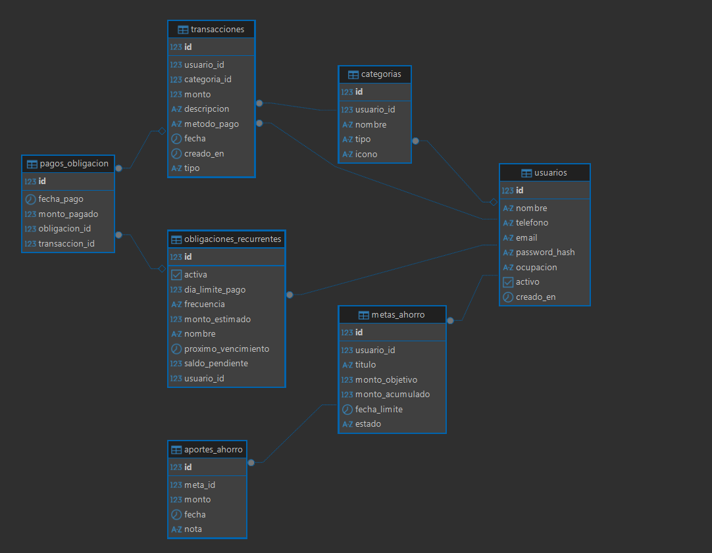

# FinanApp - Backend API

> **API RESTful de gestión financiera y control de flujo de efectivo diseñada para trabajadores independientes e informales.**  
> Construida con **Java 17 / 21**, **Spring Boot**, **Spring Security (OAuth2 / JWT)**, **PostgreSQL** y documentada con **OpenAPI 3 (Swagger)**.

---

##  Contexto y Propuesta de Valor

En América Latina, más del 50% de la fuerza laboral pertenece al sector informal (repartidores, mototaxistas, comerciantes, artesanos, trabajadores independientes). A diferencia de los empleados tradicionales, este sector:
* No cuenta con nóminas fijas mensuales; sus ingresos varían día a día.
* Es vulnerable a préstamos informales de alto costo ("paga diario").
* Carece de herramientas bancarias adaptadas a su realidad financiera.

**FinanApp** resuelve este problema mediante:
1. **Registro ágil de flujo diario:** Clasificación de ingresos y gastos en segundos.
2. **Cálculo de Cuota Diaria de Seguridad:** Algoritmo que divide el saldo pendiente de deudas entre los días restantes hasta el vencimiento, garantizando que el usuario sepa exactamente cuánto apartar cada día.
3. **Cajitas de Ahorro Dinámicas:** Metas con aportes y retiros controlados que se integran automáticamente a la contabilidad diaria.
4. **Historial contable inmutable:** Protección de integridad para que no se eliminen transacciones vinculadas a pagos de deudas o ahorros.

---

##  Stack Tecnológico

| Componente | Tecnología / Librería | Versión |
| :--- | :--- | :--- |
| **Lenguaje** | Java (JDK) | 17+ / 21 |
| **Framework** | Spring Boot | 3.x / 4.x |
| **Seguridad** | Spring Security + Nimbus JOSE JWT | Stateless OAuth2 Resource Server |
| **Persistencia** | Spring Data JPA / Hibernate | 7.x |
| **Base de Datos** | PostgreSQL | 15+ |
| **Pruebas Unitarias**| JUnit 5 + Mockito | Test-Driven Isolation |
| **Documentación API**| SpringDoc OpenAPI | OpenAPI 3 / Swagger UI |
| **Contenedorización**| Docker | Multi-stage build |
| **Build Tool** | Apache Maven | 3.9+ |

---

## 🏛️ Arquitectura del Sistema

El proyecto sigue una **Arquitectura en Capas (Layered Architecture)** bajo principios **SOLID**:

```
finanapp-backend/
├── src/
│   ├── main/
│   │   ├── java/com/finanapp/
│   │   │   ├── config/          # Seguridad (JWT, CORS), Swagger OpenAPI
│   │   │   ├── controller/      # Endpoints REST (Controladores)
│   │   │   ├── dto/             # Data Transfer Objects (Java Records inmutables)
│   │   │   ├── exception/       # Manejador Global de Excepciones (@RestControllerAdvice)
│   │   │   ├── model/           # Entidades JPA (Dominio)
│   │   │   ├── repository/      # Repositorios JPA y consultas nativas / JPQL
│   │   │   └── service/         # Lógica de Negocio y Reglas Transaccionales
│   │   └── resources/
│   │       ├── application.properties
│   └── test/                    # Pruebas unitarias de servicios con Mockito
├── Dockerfile                   # Imagen multi-stage optimizada
└── pom.xml                      # Dependencias y configuración de Maven
```

### Patrones y Buenas Prácticas Aplicadas:
* **Separación de Responsabilidades:** Controladores desacoplados de la lógica de negocio; servicios transaccionales (`@Transactional`).
* **Protección del Dominio con DTOs:** Uso de `record` en Java para asegurar inmutabilidad y evitar sobreexposición de entidades JPA.
* **Autenticación sin Estado (Stateless):** Emisión y verificación de tokens JWT firmados con algoritmo HMAC-SHA256.
* **Manejo Centralizado de Excepciones:** Respuestas estandarizadas con códigos HTTP coherentes (`400 Bad Request`, `401 Unauthorized`, `403 Forbidden`, `404 Not Found`, `409 Conflict`).
* **Soft Delete:** Eliminación lógica de usuarios y obligaciones para preservar la trazabilidad histórica de los movimientos.

---

## 🗄️ Modelo de Datos (Diagrama ER)



---

##  Catálogo de Endpoints de la API

Todos los endpoints (a excepción de autenticación y registro) requieren el encabezado:  
`Authorization: Bearer <TOKEN_JWT>`

### 1. Autenticación (`/api/auth`)
| Método | Endpoint | Descripción | Acceso |
| :--- | :--- | :--- | :--- |
| `POST` | `/api/auth/login` | Inicia sesión con correo y contraseña. Retorna token JWT y perfil. | Público |

### 2. Usuarios (`/api/usuario`)
| Método | Endpoint | Descripción | Acceso |
| :--- | :--- | :--- | :--- |
| `POST` | `/api/usuario` | Registro de nuevo usuario (valida email y teléfono únicos). | Público |
| `GET` | `/api/usuario/perfil` | Consulta el perfil del usuario autenticado vía token. | Autenticado |
| `PATCH` | `/api/usuario/actualizar` | Actualización de nombre y/u ocupación. | Autenticado |
| `DELETE` | `/api/usuario/desactivar` | Desactivación lógica de la cuenta (*Soft Delete*). | Autenticado |

### 3. Categorías (`/api/categoria`)
| Método | Endpoint | Descripción | Acceso |
| :--- | :--- | :--- | :--- |
| `POST` | `/api/categoria` | Crea una categoría personalizada para el usuario. | Autenticado |
| `GET` | `/api/categoria/listar` | Lista categorías globales y creadas por el usuario (soporta `?tipo=INGRESO\|GASTO`). | Autenticado |
| `PATCH` | `/api/categoria/actualizar/{id}` | Actualiza nombre, ícono o tipo de una categoría propia. | Autenticado |
| `DELETE` | `/api/categoria/eliminar/{id}` | Elimina una categoría propia (protege las categorías base). | Autenticado |

### 4. Transacciones (`/api/transaccion`)
| Método | Endpoint | Descripción | Acceso |
| :--- | :--- | :--- | :--- |
| `POST` | `/api/transaccion` | Registra un ingreso o gasto. | Autenticado |
| `GET` | `/api/transaccion/usuario` | Lista transacciones del usuario con filtros opcionales (`?fechaInicio=&fechaFin=`). | Autenticado |
| `GET` | `/api/transaccion/usuario/balance` | Balance diario: suma de ingresos, gastos, neto y total de movimientos (`?fecha=`). | Autenticado |
| `PATCH` | `/api/transaccion/{id}` | Modifica una transacción (valida que no provenga de un pago de deuda). | Autenticado |
| `DELETE` | `/api/transaccion/{id}` | Elimina una transacción del usuario. | Autenticado |

### 5. Metas y Cajitas de Ahorro (`/api/ahorros-metas`)
| Método | Endpoint | Descripción | Acceso |
| :--- | :--- | :--- | :--- |
| `POST` | `/api/ahorros-metas` | Crea una meta de ahorro con monto objetivo y fecha límite. | Autenticado |
| `GET` | `/api/ahorros-metas` | Obtiene todas las metas del usuario. | Autenticado |
| `GET` | `/api/ahorros-metas/metas` | Filtra metas por estado (`?estadoMeta=EN_PROGRESO\|COMPLETADA\|CANCELADA`). | Autenticado |
| `GET` | `/api/ahorros-metas/ahorrado` | Retorna el valor total acumulado ahorrado por el usuario. | Autenticado |
| `PATCH` | `/api/ahorros-metas/{id}` | Actualiza título, fecha o monto objetivo (recalcula si se completa). | Autenticado |
| `DELETE` | `/api/ahorros-metas/{id}` | Cancela una meta de ahorro (*Soft Delete*). | Autenticado |

### 6. Aportes y Retiros de Ahorro (`/api/aportes`)
| Método | Endpoint | Descripción | Acceso |
| :--- | :--- | :--- | :--- |
| `POST` | `/api/aportes` | Abona a una meta, suma al acumulado y genera transacción contable de `GASTO`. | Autenticado |
| `POST` | `/api/aportes/retiro` | Retira dinero de una meta (valida saldo suficiente) y genera transacción de `INGRESO`. | Autenticado |
| `GET` | `/api/aportes/historial/{metaId}` | Historial de aportes de una meta específica. | Autenticado |

### 7. Obligaciones Recurrentes y Deudas (`/api/obligaciones`)
| Método | Endpoint | Descripción | Acceso |
| :--- | :--- | :--- | :--- |
| `POST` | `/api/obligaciones` | Registra obligación (diaria, semanal, quincenal, mensual). | Autenticado |
| `GET` | `/api/obligaciones/usuario` | Lista todas las obligaciones y actualiza vencimientos pendientes. | Autenticado |
| `GET` | `/api/obligaciones/usuario/activas` | Lista solo obligaciones activas. | Autenticado |
| `GET` | `/api/obligaciones/{estado}` | Filtra obligaciones por estado (`PENDIENTE`, `PAGADA`, `VENCIDA`). | Autenticado |
| `GET` | `/api/obligaciones/usuario/cuota-seguridad` | **Cuota Diaria de Seguridad:** Saldo pendiente / días para vencer. | Autenticado |
| `PATCH` | `/api/obligaciones/{id}` | Actualiza datos de la obligación. | Autenticado |
| `DELETE` | `/api/obligaciones/{id}` | Desactiva una obligación (*Soft Delete*). | Autenticado |

### 8. Pagos de Obligaciones (`/api/pagos`)
| Método | Endpoint | Descripción | Acceso |
| :--- | :--- | :--- | :--- |
| `POST` | `/api/pagos` | Realiza un pago/abono, reduce saldo de la deuda y crea transacción de gasto. | Autenticado |
| `GET` | `/api/pagos/obligaciones/{id}` | Historial de pagos realizados a una obligación específica. | Autenticado |

---

## Pruebas Unitarias

El backend cuenta con una suite integral de pruebas unitarias implementadas con **JUnit 5** y **Mockito**, garantizando la cobertura de casos de éxito y caminos excepcionales para la lógica de negocio:

* **UsuarioServiceTest:** Validaciones de duplicados, encriptación BCrypt, actualización y desactivación.
* **AuthLoginTest:** Autenticación con JWT, rechazo por credenciales incorrectas o usuario inactivo.
* **TransaccionTest:** Registro contable, reglas de negocio para usuarios inactivos y cálculo de balance.
* **AporteAhorroTest:** Incremento de acumulados, auto-completado de metas y protección contra retiros superiores al saldo.
* **PagoObligacionTest:** Reducción de saldos, cambio a estado pagado y bloqueo de sobrepagos.

Para ejecutar la suite de pruebas:
```bash
cd finanapp-backend
./mvnw test
```

---

## 🚀 Despliegue y Ejecución Local

### Prerrequisitos
* **Java 17 o 21 (JDK)**
* **PostgreSQL** corriendo en el puerto `5432` con una base de datos llamada `finanapp_db`.
* **Docker** (opcional, para ejecución contenerizada).

### 1. Clonar el Repositorio
```bash
git clone https://github.com/Navid2405/finan-app.git
cd finan-app/finanapp-backend
```

### 2. Configurar Variables de Entorno (`.env`)
Crea un archivo `.env` en la raíz de `finanapp-backend/`:
```env
DB_URL=jdbc:postgresql://localhost:5432/finanapp_db
DB_USERNAME=postgres
DB_PASSWORD=tu_password_aqui
JWT_SECRET=tuClaveSecretaSuperLargaYSeguraDeMinimo32Caracteres1234567890
PORT=8081
```

### 3. Ejecutar la Aplicación

**Opción A: Desde Terminal con Maven Wrapper**
```bash
./mvnw spring-boot:run
```

**Opción B: Con Docker**
```bash
# Construir la imagen
docker build -t finanapp-backend .

# Correr el contenedor
docker run -p 8081:8081 --env-file .env finanapp-backend
```

---

##  Documentación Interactiva (Swagger UI)

Una vez iniciada la aplicación, accede a la documentación interactiva y realiza pruebas en vivo desde el navegador:

 **[http://localhost:8081/swagger-ui/index.html](http://localhost:8081/swagger-ui/index.html)**

---

##  Autor

* **Navid Lobato** - Estudiante de Ingeniería de Software, Universidad de Cartagena.
* GitHub: [@Navid2405](https://github.com/Navid2405)
