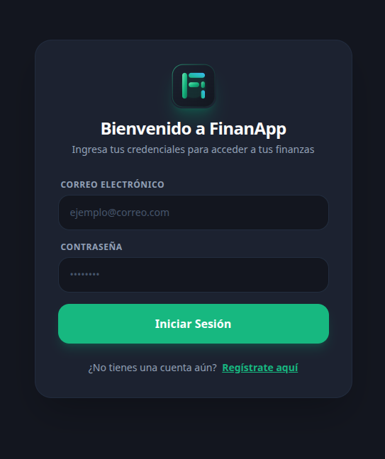
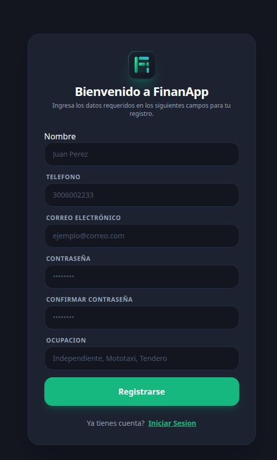
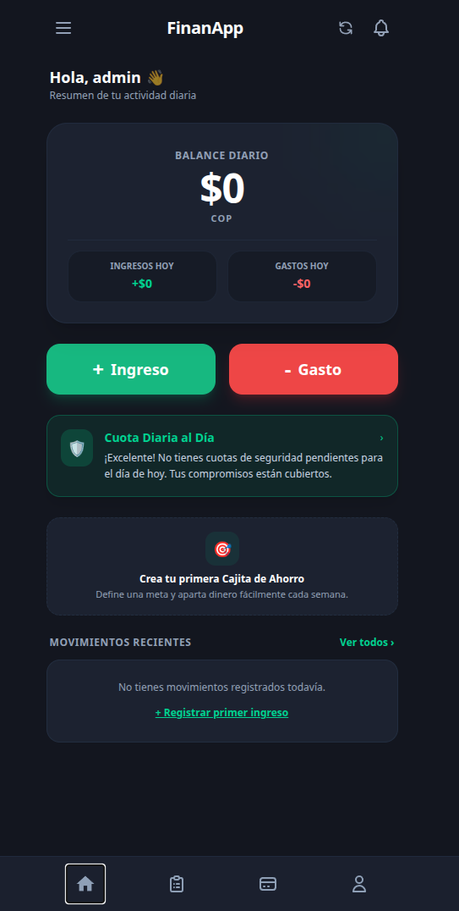
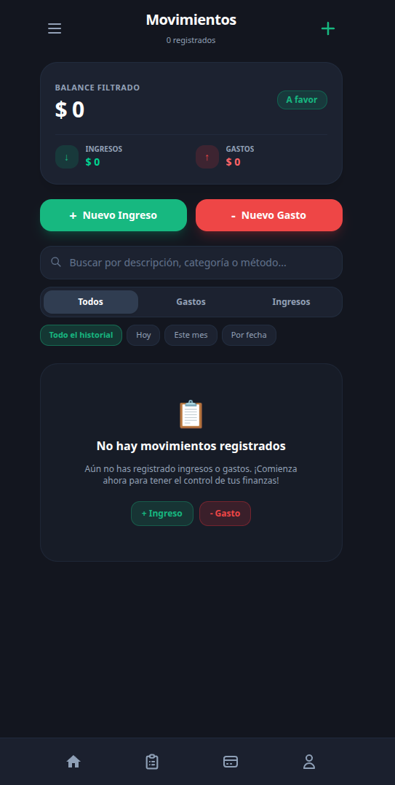
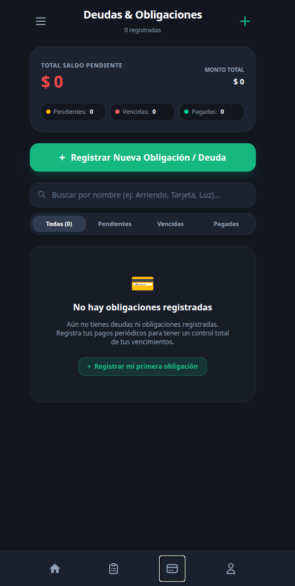
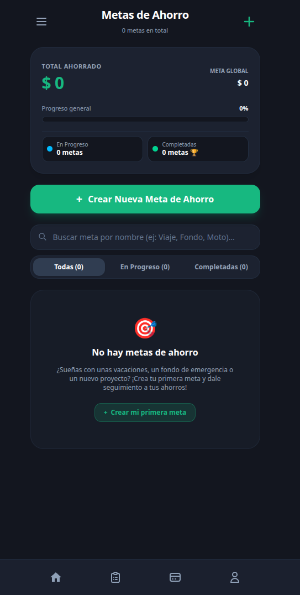
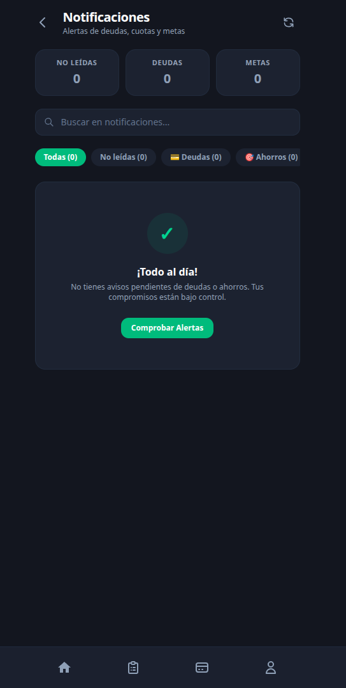
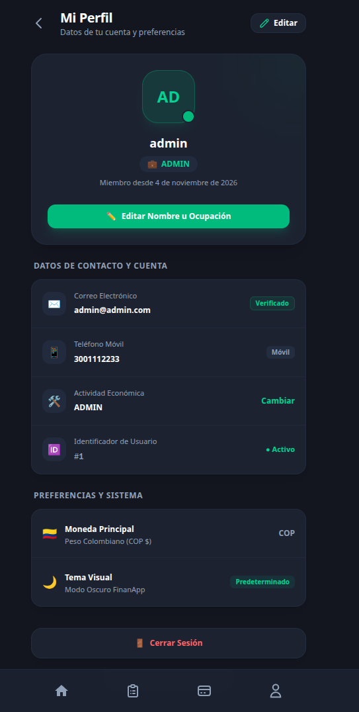
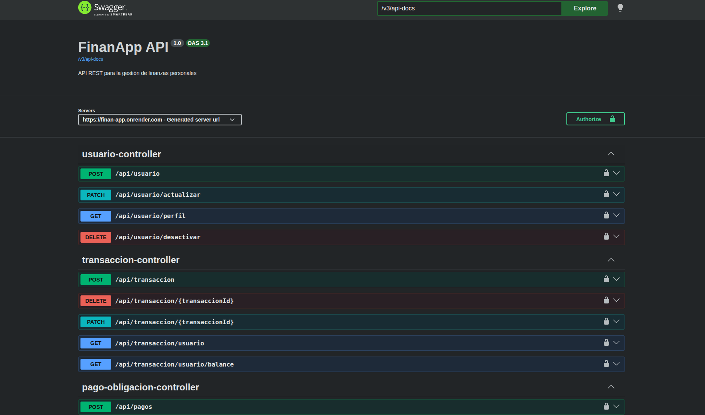
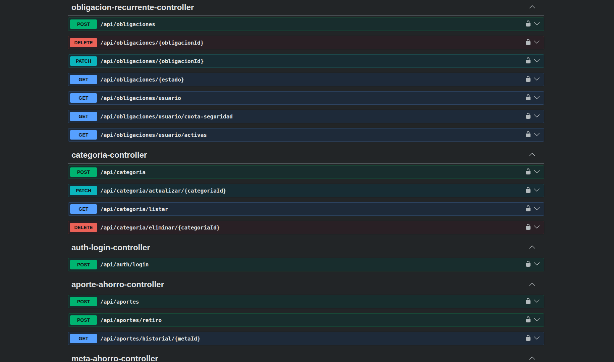

#  FinanApp — Guía de Capturas de Pantalla (Screenshots)

Esta carpeta almacena las capturas oficiales de la aplicación para el `README.md`, presentaciones de sustentación y portafolio técnico.

---

##  Lista de Capturas y Elementos Requeridos

| Archivo | Pantalla / Módulo | Elementos Clave que deben verse |
| :--- | :--- | :--- |
|  | Login y Registro | Formulario estilizado con Tailwind CSS, campos de validación, logo de FinanApp. |
| | Dashboard Principal | Tarjetas de balance diario (ingresos, gastos, saldo neto), widget de cuota de seguridad activa y metas de ahorro. |
|  | Flujo de Caja | Listado de transacciones con badges de tipo (`INGRESO` / `GASTO`), iconos de categorías y filtros por fecha. |
| | Obligaciones Recurrentes | Tarjetas de deudas con cálculo dinámico de la cuota diaria de seguridad, barra de saldo y modal de abono. |
|  | Cajitas de Ahorro | Metas activas con porcentaje de avance, monto ahorrado vs objetivo y modales de aportes/retiros. |
|  | Centro de Notificaciones | Panel de alertas inteligentes categorizadas (vencimientos de deudas, metas cumplidas, balance diario). |
|  | Perfil de Usuario | Datos del usuario autenticado, actualización de perfil y opción de desactivación de cuenta (*Soft Delete*). |
|   | Swagger UI (OpenAPI 3) | Vista general de endpoints organizados por tags, esquema de seguridad Bearer JWT y modelos de datos tipados. |
